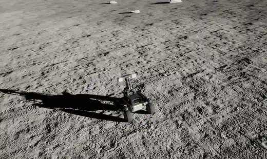
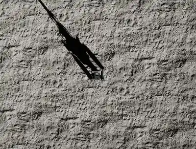
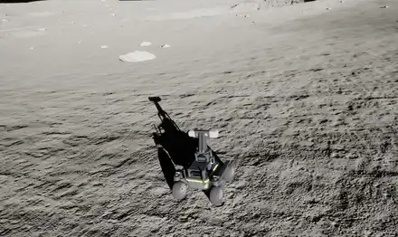

# GNC-Moon-Simulator

A guidance, navigation and control (GNC) stack in ROS 2 for lunar rovers
simulated in Unreal Engine 5. The rover drives itself to goals over generated
lunar terrain, using stereo navcams, lidar, IMU, and event and SPAD cameras,
watched and commanded from a web mission control.



*Leo_Raph driving autonomously to a goal 16 m away, past rocks, until it parks
at the goal (Unreal's orbit camera, 6x speed).*

| Top-down camera | Follow camera |
|---|---|
|  |  |

The same route from the top-down and follow cameras. Full videos (2x speed):
[orbit](docs/videos/drive_orbit.mp4), [top-down](docs/videos/drive_top.mp4),
[follow](docs/videos/drive_follow.mp4).

## Mission control


*The overview during that drive, replayed from its rosbag (3x speed;
[video](docs/videos/overview.mp4)): the navcams with the planned path drawn on
them, segmentation and shadow masks, the global map following the rover, lidar
and local elevation map, telemetry and the ROS log.*

| Teleoperation | System |
|---|---|
|  |  |
| **Camera wall** | **Bags** |
|  |  |

More in [docs/mission-control.md](docs/mission-control.md).

## The project

This repository is the ROS side and the entry point of the project:

| Repository | What it holds |
|---|---|
| **GNC-Moon-Simulator** (this one) | ROS 2 nodes, one Docker container each; web dashboard; MCP server for AI agents |
| [MARE-Lunar-Simulator](https://github.com/raulcastar/MARE-Lunar-Simulator) | The Unreal project: levels, rovers (Leo_Raph, Yutu), sensor plugins |
| [Unreal-Moon-Terrain-Generation](https://github.com/raulcastar/Unreal-Moon-Terrain-Generation) | Terrain Studio: terrain, craters, rocks, ground-truth masks, sun |
| [UnrealStereoCam](https://github.com/raulcastar/UnrealStereoCam), [UnrealLidarCam](https://github.com/raulcastar/UnrealLidarCam), [UnrealEventCam](https://github.com/raulcastar/UnrealEventCam), [UnrealSPADCam](https://github.com/raulcastar/UnrealSPADCam), [UnrealSimClock](https://github.com/raulcastar/UnrealSimClock) | The sensor plugins, each usable on its own |

## Requirements

- Windows with WSL2 and Docker (the stack runs in containers on ROS 2 Jazzy).
- Unreal Engine 5.7 on the same machine, with the MARE-Lunar-Simulator project.
- About 32 GB of RAM to run Unreal and the stack together.

## Quick start

1. Set up WSL2 with mirrored networking: [docs/setup.md](docs/setup.md#host-wsl2-and-docker).
2. Build and start the stack (the first build takes a while):
   ```bash
   ./docker_build.sh
   ```
3. Open the Unreal project, open `Lunar_Terrain_Raph` and press **Play**. The
   sensor plugins and the rover connect to the containers on `127.0.0.1`.
4. Open mission control at **http://127.0.0.1:5000**, then click on the map in
   the overview to send the rover to a goal.

A container restart does not pick up code changes: see
[Applying code changes](docs/setup.md#applying-code-changes).

## Components

| Package | Role |
|---|---|
| `component_rover_leo_raph` | Rover base: `/cmd_vel` to wheel speeds, Unreal telemetry to `/odom` and TF |
| `component_robot_description` | The rover's fixed frames as static TF, from a URDF exported from Unreal |
| `component_sim_clock` | `/clock` from Unreal's simulation time |
| `component_stereo_depth` | Navcam images, SGBM stereo depth, ground-truth depth, object and shadow masks |
| `component_lidar` | Lidar point cloud |
| `component_imu` | Simulated IMU from odometry |
| `component_event_camera` | Event (DVS) camera |
| `component_spad_camera` | Single-photon (SPAD) camera, with spadSim's photon model |
| `component_local_mapping` | Local elevation map and point cloud from stereo depth |
| `component_path_planner` | Missions, global route (fast marching), local planner (DWA), lidar obstacle avoidance |
| `mission_control_dashboard` | Web mission control and a JSON API |
| `custom_map_interfaces` | The `GetMatrices` service (the planner's maps) |

## AI agents (MCP)

`mcp/gnc_mcp.py` is an MCP server, so an AI agent (Claude Code, Claude Desktop
or any MCP client) can use the running simulator: read the status, log and
camera images, send goals and wait for them, drive, stop, switch the lights,
obstacle avoidance, viewport camera and rover, restart nodes and record bags.
It wraps the dashboard's JSON API (`http://127.0.0.1:5001/api/`), which plain
scripts can call too.

```bash
py -m pip install -r mcp/requirements.txt          # once
claude mcp add gnc -- py "<repo>/mcp/gnc_mcp.py"   # or use the repo's .mcp.json
```

Commands that move the rover are refused while Unreal is not in Play. Terrain
Studio has its own MCP server for building terrain and starting Play; details in
[docs/mission-control.md](docs/mission-control.md#json-api-and-ai-agents-mcp).

## Documentation

| | |
|---|---|
| [Setup](docs/setup.md) | WSL2 and Docker, building, applying code changes, ROS tools |
| [The Unreal side](docs/unreal.md) | Project and plugins, links and ports, simulation time, project settings |
| [Rovers](docs/rovers.md) | Leo_Raph and Yutu, switching rovers, the rover node, gravity, TF tree |
| [Perception](docs/perception.md) | Navcam rig and stereo depth, masks, local mapping, other sensors |
| [Path planner](docs/path-planner.md) | Modules, mission states, obstacle avoidance, maps |
| [Mission control](docs/mission-control.md) | Dashboard screens, bags, viewport cameras, JSON API and MCP |
| [Testing](docs/testing.md) | Unit tests, scenarios with Unreal in Play, commanding by hand |
| [AGENTS.md](AGENTS.md) | Guidance for AI coding agents working in this repo |

## License

[MIT](LICENSE), © 2026 Raul Castilla Arquillo, except for the parts below,
which keep their own licences:

- `component_spad_camera/src/spad_model.py`: ported from
  [spadSim](https://github.com/drodriguezSRL/spadSim), MIT, © 2025 David
  Rodriguez-Martinez (see [its LICENSE](component_spad_camera/LICENSE)).
- `component_path_planner/src/local_planner.py`: the DWA, based on
  [PythonRobotics](https://github.com/AtsushiSakai/PythonRobotics), MIT,
  © 2016 - now Atsushi Sakai and other contributors (notice in the file).
- `component_path_planner/src/fast_marching.py` and `planner_maps.py` (and
  their tests): based on the [DyMu path planner](https://github.com/spaceuma/ARES-DyMu_python)
  by J. Ricardo Sánchez Ibáñez and Gonzalo Paz Delgado, which is published
  under GPL-3.0.

The Yutu rover model is CC-BY-4.0 (credit in [docs/rovers.md](docs/rovers.md#adding-a-rover-how-yutu-was-built));
the plugins and the Unreal project list their own third-party content.
