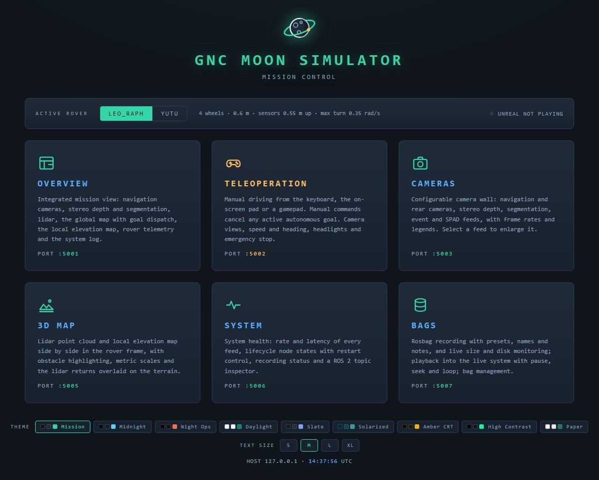
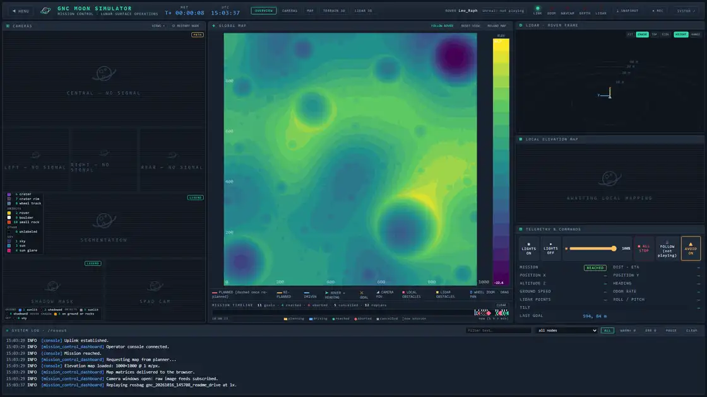
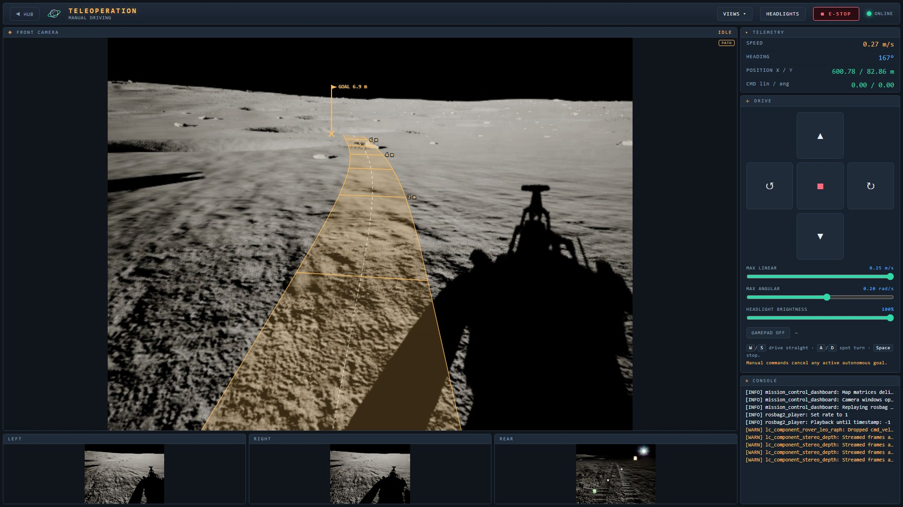
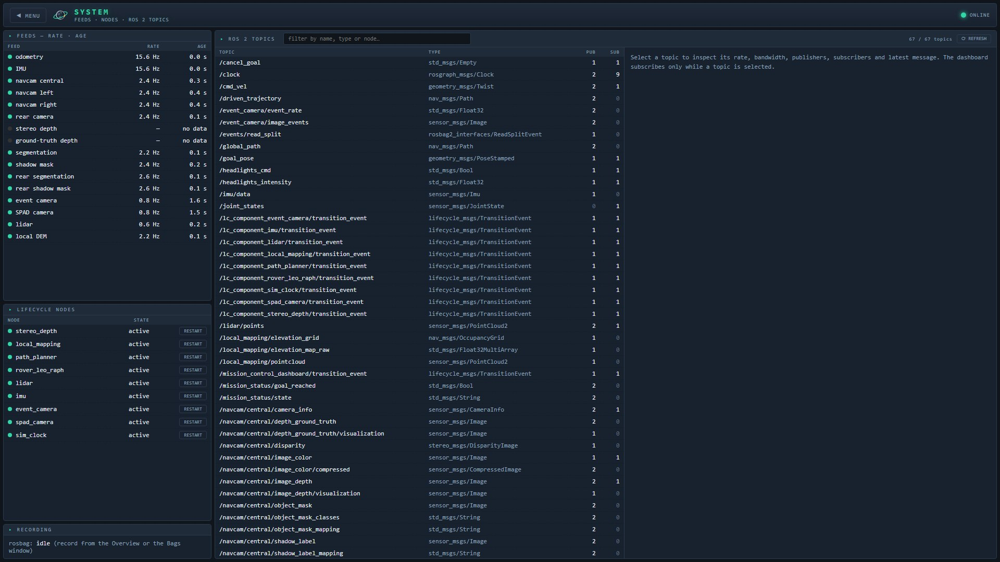
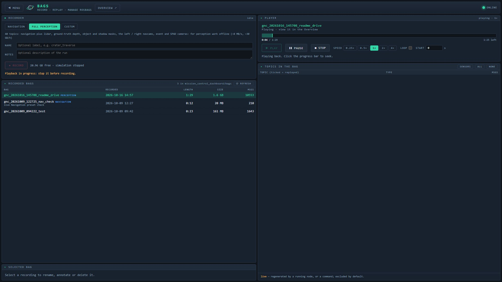
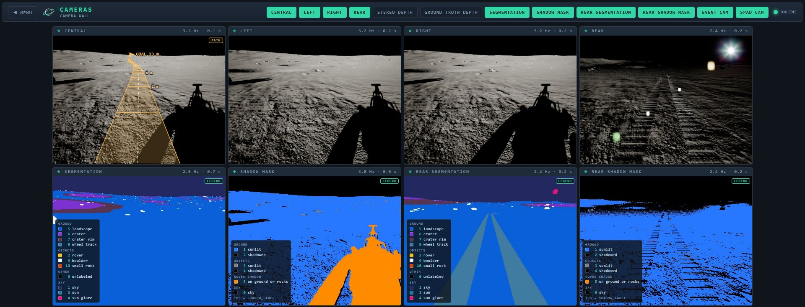

# Mission control

`mission_control_dashboard` is one ROS node behind several web servers (Flask +
SocketIO, wall clock):

| Port | Screen |
|---|---|
| 5000 | Menu linking to the others, with the ROVER selector ([Rovers](rovers.md)) |
| 5001 | **Overview:** navcam feeds with the route, goal, re-plans and obstacles drawn on them; lidar; local DEM; the global map with click-to-goal, the route, re-plans, obstacles and the driven path (FOLLOW ROVER zooms in on the rover); telemetry; mission timeline; `/rosout` console; lights, ALL STOP, 🎥 VIEW (Unreal's viewport camera), ⛰ AVOID, snapshot and record |
| 5002 | Teleop: drive-by-wire, bypassing the planner, with a deadman (a node-side watchdog stops the rover if commands stop) |
| 5003 | Camera wall with per-feed toggles |
| 5005 | 3D map: lidar and local DEM side by side |
| 5006 | System: feed rates, lifecycle nodes (restart), remote parameters, ROS 2 topics |
| 5007 | Bags: record with presets, names and notes; replay into the live system; rename and delete |



*The menu (5000): the screens, the ROVER selector and the colour themes.*



*The overview (5001) through a drive, replayed from its rosbag (3x speed), with
FOLLOW ROVER on: the route ahead of the rover on the navcam and the map, the
lidar and the local elevation map.*



*Teleoperation (5002): the front camera, the side and rear cameras, telemetry
and the drive pad.*



*System (5006): feed rates and ages, lifecycle nodes with restart, and the ROS 2
topics.*



*Bags (5007): the recorder with its presets, the recorded bags, and the player.*



*The camera wall (5003): the central, left, right and rear cameras, and their
segmentation and shadow masks with legends.*

## Bags

Bags are written to `mission_control_dashboard/bags/` (git-ignored) and record
`/clock`, so a replay runs on the recorded time. The BAGS screen plays a bag
back into the live system (stop Play in Unreal first): the sensors are
replayed and the GNC nodes recompute their outputs from them.

## Viewport cameras

`unreal/python/rover_cameras.py` sets Unreal's Play viewport to the rover's
follow camera (the Blueprint's `FollowArm` spring arm, a three-quarter rear
view that keeps the wheel tracks in frame), an **orbit** around the rover, or a
**top-down** view above it. The orbit and top-down views move a level actor
tagged `RoverOrbitCamera` every frame; they only read the rover.

The Unreal project already has both scripts in its `Content/Python/`; this
folder holds their source, so after editing one here, copy it there. For a new
project: copy `rover_cameras.py` and `rover_cameras_startup.py` to
`<Project>/Content/Python/`, add `rover_cameras_startup.py` to *Project Settings
→ Python → Startup Scripts*, and run `rover_cameras.install()` once with Play
stopped (it places the camera actor; save the level). The startup script polls
the dashboard's `GET /viewport_camera` (port 5001), so the overview's 🎥 VIEW
button cycles follow → orbit → top. From the editor's Python console:
`rc.orbit(radius=6, height=2.5, period=45)`, `rc.top(height=15)`,
`rc.follow()` (`import rover_cameras as rc`).

## JSON API and AI agents (MCP)

The dashboard serves a JSON API on port 5001
(`mission_control_dashboard/src/api.py`, `http://127.0.0.1:5001/api/...`), and
`mcp/gnc_mcp.py` wraps it as an MCP server, so an AI agent (Claude Code, Claude
Desktop or any MCP client) can use the running simulator:

- **Read:** status, log, camera images, the rover.
- **Drive:** goals (and waiting for them), timed manual drives, stop.
- **Settings and maintenance:** headlights, obstacle avoidance, viewport
  camera, rover switch, node restarts, rosbag recording.

```bash
py -m pip install -r mcp/requirements.txt         # once, on the host
claude mcp add gnc -- py "<repo>/mcp/gnc_mcp.py"  # or use the repo's .mcp.json
curl 127.0.0.1:5001/api/status                    # the API without MCP
```

Use `127.0.0.1`, not `localhost`: on Windows, `localhost` tries IPv6 first and
costs about 20 s per request. Commands that move the rover are refused while
Unreal is not in Play; manual drives are clamped to the teleop limits and
always end stopped. Terrain Studio has its own MCP server for building terrain
and starting or stopping Play. [AGENTS.md](../AGENTS.md) has guidance for
coding agents working in this repo.
